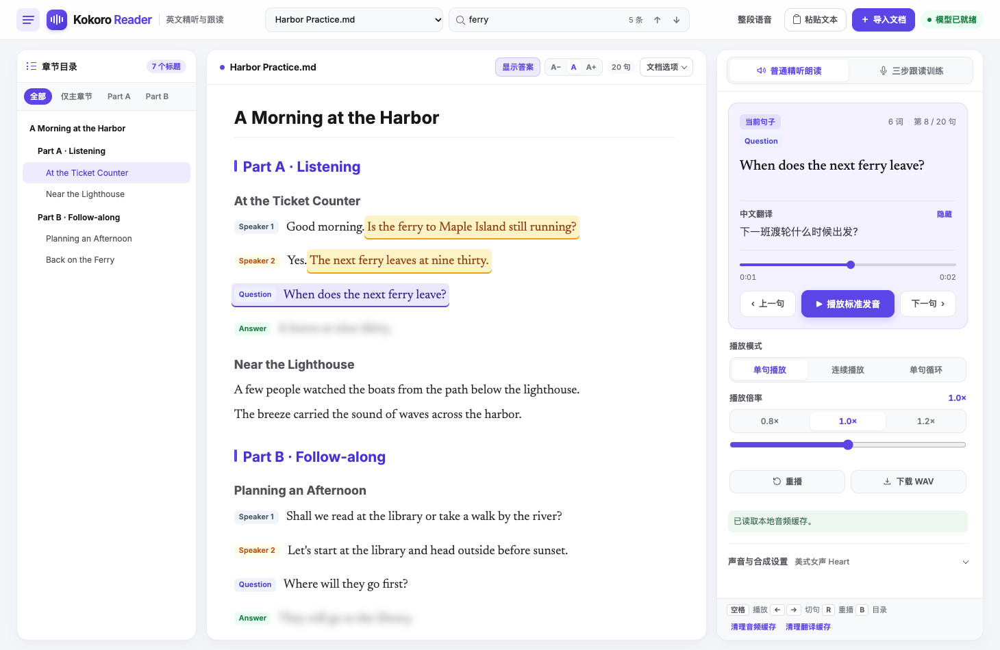
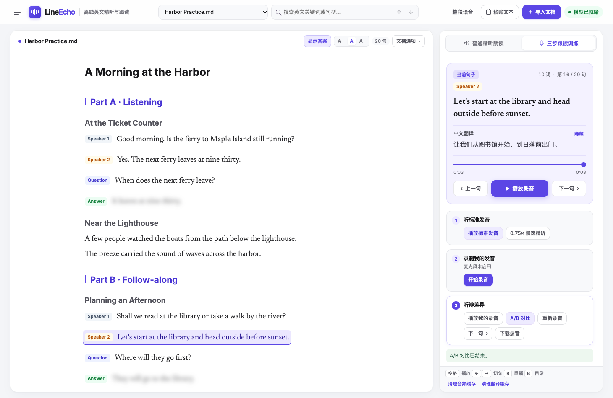

# LineEcho

**离线英文精听与跟读**

在 Apple Silicon Mac 上使用 Kokoro-82M 逐句朗读英文文档，查看本地简体中文翻译，并通过录音回听和 A/B 对比练习发音。模型、文档和缓存均在本机。桌面版在应用窗口中使用，网页版服务监听 `127.0.0.1:7860`。

## 下载 macOS 应用


**系统要求** · Apple Silicon Mac（M 系列），macOS 26 或更新版本。

1. 从 [v0.1.2 发布页](https://github.com/Wangxmian/LineEcho/releases/tag/v0.1.2) 下载 [LineEcho-0.1.2-arm64.dmg](https://github.com/Wangxmian/LineEcho/releases/download/v0.1.2/LineEcho-0.1.2-arm64.dmg)。
2. 双击打开磁盘映像，将 **LineEcho.app** 拖到「应用程序」，再从「应用程序」双击打开。
3. 在右侧的跟读模式首次开始录音时允许麦克风访问。下载 WAV 或录音时可用 macOS 保存面板选择位置。

**Apple 公证状态** · 此版本使用临时签名（ad hoc），尚未完成 Developer ID 签名和 Apple 公证。从 GitHub 下载后，macOS 可能默认阻止打开。请先核对下载来源，再参阅 [Apple 关于安全打开 Mac 应用的说明](https://support.apple.com/zh-cn/102445)。

应用内置 Python、Node.js、Kokoro-82M 和 MTranServer 英译简中模型，首次使用也可离线导入文档、朗读、翻译、录音和保存音频。从 Kokoro Reader 升级时，LineEcho 会直接读取 `~/Library/Application Support/Kokoro Reader/` 中的文档、阅读进度和缓存，无需迁移。确认新版可打开后，可以将旧的 `Kokoro Reader.app` 移到废纸篓。网页项目里的文档可以通过顶部的「导入文档」重新导入。

开发者可以在准备好项目环境、两个模型和 Xcode Command Line Tools 后执行 `./scripts/build-macos.command`，输出位于 `outputs/macos/`。参见[随包分发的第三方组件及许可证](macos/ThirdPartyNotices.md)。

## 界面预览

**普通朗读** · 用目录和关键词搜索定位句子，练习时可以遮罩答案。右侧显示原文、离线译文和播放进度，也能调倍率或下载 WAV。



**三步跟读训练** · 听标准发音、录制自己的发音，再进行 A/B 对比或下载录音。



## 启动网页版

首次使用请先按下方「安装与修复」的步骤安装依赖和模型。

在 Finder 打开项目文件夹，双击 **start.command**。模型就绪后，浏览器会打开 [LineEcho](http://127.0.0.1:7860)。使用完毕后双击 **stop.command**。

原来的文本转语音页面位于 [整段语音](http://127.0.0.1:7860/tts)，可继续输入英文并生成一整段 WAV。整段模式支持单次最多 12,000 个字符。

## 阅读文档

1. 上传或拖拽 `.docx`、`.md`、`.markdown`、`.txt` 到左侧，也可以点击 **粘贴文本**。文件上限 8 MB，文档上限 240,000 个字符和 12,000 个朗读单元。旧版 `.doc` 请先在 Word 中另存为 `.docx`。
2. 在阅读区顶部的 **文档选项** 中切换智能分句和按行分割。多行粘贴默认按行，导入文件默认智能分句。智能分句考虑常见英文头衔、缩写和小数。代码块、图片和 Markdown 链接地址不参与朗读。
3. 点击左侧任意句子即可生成并播放。播放器显示当前句子、位置和进度，长句可以展开。可以重播、拖动进度或下载当前 WAV。
4. **单句播放** 在当前句结束后停止。**连续播放** 在当前句结束后播放下一句。**单句循环** 重复当前句。
5. **Space** 播放或暂停，**←** 和 **→** 切句，**R** 重播。输入文字或操作输入控件时保留原生按键行为。

使用顶部搜索框查找当前文档中的英文关键词。可以点击结果，也可以用搜索框右侧的上下箭头依次跳转。搜索与章节跳转会选中句子并定位，点击正文或播放按钮后才开始朗读。左侧目录使用 Word 和 Markdown 的实际标题。目录默认收起，点击顶部目录按钮或按 **B** 可展开，支持仅显示主章节。阅读区工具栏可调字号，识别出 Answer 标签后可使用答案遮罩。`Speaker 1:`、`Question:` 等行首角色标签会独立显示。分行成对的 `Question How many…` 和 `Answer Three.` 也能识别，朗读使用标签后的英文内容。 题号（如 `A01`、`B001`）会单独显示，仍可搜索。逐句朗读、跟读示范和翻译使用题号后的正文。

在 **普通朗读** 里选择常用播放倍率或拖动滑块，浏览器会实时调整已有标准音频。**声音设置** 中的 Kokoro 生成语速作用于下一次合成和下载的 WAV，仍与文本、音色一起参与缓存。生成语速可在 0.7×～1.3× 调节。

应用会保存每份文档的分割模式和选句位置。重新打开文档时会定位到上次选中的句子，点击播放即可继续。文档库的 **删除** 只移除项目里导入的文本副本。

## 逐句中文翻译

选句、切句、连续播放和跟读训练时，「当前句子」卡片在英文下方显示对应的简体中文。翻译复用参与朗读的英文正文，角色标签单独展示。点击 **隐藏** 可关闭翻译，刷新后会保留该偏好。翻译出错时可点 **重试翻译**，英文播放和录音仍可使用。

安装 [MTranServer](https://github.com/xxnuo/MTranServer) 后，Reader 优先使用 5.1.1 版本转换的 Mozilla 英译简中 v3.0 ONNX 模型。运行时用 CPU 推理，由同一个 `start.command` 管理，页面仍使用原来的本地端口。未安装此模型的项目可继续使用 [Helsinki-NLP/opus-mt-en-zh](https://huggingface.co/Helsinki-NLP/opus-mt-en-zh)。服务只对当前句子按需请求翻译，重复句子可跨文档复用缓存。缓存键包含模型版本，切换翻译模型后会重新生成译文。

## 中英文混排

阅读区只显示可朗读的英文。导入时按 Unicode 字符属性识别汉字和非拉丁文字，按中文标点与文字片段保留边界，再进行智能分句或按行分割。纯中文行和仅有数字、标点的文档片段不会出现在朗读队列。明确的纯中文括号注释会被去除，保留前后的英文。纯中文导入会显示「未检测到可朗读的英文内容」。

首次打开旧文档时，阅读器会从已存的原文段落更新朗读单元，并按原位置恢复最近的英文句子。原始文件、文档记录和已有标准音频缓存会保留。

## 跟读训练

1. 切换至右侧 **跟读训练** 选项卡，按听标准发音、录制、听辨三个步骤练习。点击 **播放标准发音** 可以单独回听 Kokoro 音频。
2. **手动跟读** 时，点击 **开始录音**，按浏览器提示允许麦克风。读完后点击 **停止录音**，再点 **播放我的录音**。
3. 展开 **训练设置** 选择 **自动跟读**，准备时间可设为 0、2、3 或 5 秒，默认 2 秒。点击 **开始跟读** 后，浏览器先确认麦克风权限，再播放标准发音并倒计时。倒计时结束后开始录音，点击 **停止录音** 会自动回放。每次录音最长 60 秒。
4. **A/B 对比** 依次播放标准发音和自己的录音，中间短暂停顿。主播放键可暂停和继续，**停止训练** 可结束当前流程。切换句子或文档会停止当前录音和播放。

录音使用浏览器的 `getUserMedia`、`MediaRecorder` 和本地音频播放器，格式由浏览器实际支持的编码决定。当前句子的录音留在浏览器内存中，需要留存时请点击 **下载录音**。如浏览器提示权限被拒绝，可检查本站和 macOS 的麦克风访问设置。发音练习以回听和 A/B 听辨为主。

## 存储与缓存

- `data/documents/` 保存提取后的文本、两种分句结果和阅读位置。
- `data/audio-cache/` 保存按需生成的 WAV 缓存。键由句子内容、音色、语速和模型版本决定，上限为 256 MiB 和 2,000 项。播放器下方的 **清理音频缓存** 可清除缓存。
- `data/translation-cache.sqlite3` 保存最多 8,000 条翻译。键由规范化文本、语言、模型版本、分段和生成参数决定。播放器下方的 **清理翻译缓存** 只清除翻译记录。
- `models/Kokoro-82M-bf16/` 保存原有模型和七个音色。`outputs/` 可保存命令行与验收输出。
- `models/MarianMT-en-zh/` 保存选用 MarianMT 时所需的权重、分词器和配置。
- `models/MTranServer/` 保存 Mozilla 源文件、语言包清单和准备好的 ONNX 模型。Node.js 依赖安装在项目的 `.runtime/mtranserver/`。

导入时仅解析文档。选句后，服务有缓存就读取缓存，首次播放则调用本地模型生成音频。连续播放也按需生成。浏览器如果拦截自动播放，点击 **播放** 即可开始。当前模型输出 24,000 Hz、单声道、16 位 PCM WAV。

## 安装与修复

本机部署使用 ARM64 Python 3.13、MLX 0.32.4、MLX-Audio 0.6.7 和 Misaki 0.7.4。安装后，依赖位于项目内的 `.venv/`，模型来自 [mlx-community/Kokoro-82M-bf16](https://huggingface.co/mlx-community/Kokoro-82M-bf16)。

首次安装或修复可在项目根目录执行下列命令。已存在且通过 SHA-256 校验的模型文件会直接复用。固定的 MLX wheel 适用于 macOS 26 或以上的 Apple Silicon Mac。安装完成后，解析、合成、播放和翻译均可离线进行。

```sh
./scripts/install.command
```

已有 Kokoro 环境可以单独运行 `./scripts/install-translation.command` 安装翻译依赖和模型，然后使用原来的 `stop.command` 和 `start.command` 重启。

使用 Node.js 18 或更新版本及 npm 时，可运行 `./scripts/install-mtran.command` 安装轻量 ONNX 翻译后端。安装脚本下载并校验 Mozilla 语言包，模型准备完成后可以断网运行。用 `stop.command` 和 `start.command` 重启 Reader 即可使用。

若启动报错，查看 Terminal 和 `.runtime/server.log`。若端口已由其他应用占用，启动脚本会提示端口冲突。

## 本地 API

| 接口 | 用途 |
| --- | --- |
| `GET /api/health` | 模型状态、设备和采样率 |
| `GET /api/voices` | 实际可用音色和语言代码 |
| `POST /api/tts` | 接收 `text`、`voice`、`speed` 并返回 WAV。响应头 `X-Kokoro-Cache` 表示命中或生成 |
| `DELETE /api/tts/cache` | 清理项目内的音频缓存 |
| `GET /api/translation/status` | 翻译模型、加载状态、实际推理设备和目标语言 |
| `POST /api/translate` | 接收 `text`、`source: "en"` 和 `target: "zh-Hans"`，返回 `translation` 和 `cached`。单次文本上限为 12,000 个字符 |
| `POST /api/translation/reload` | 翻译模型加载失败后重试 |
| `DELETE /api/translation/cache` | 清理 SQLite 翻译缓存 |
| `GET /api/documents` | 列出已导入的文档 |
| `POST /api/documents/upload` | 通过 multipart 表单字段 `file` 导入文件 |
| `POST /api/documents/text` | 接收 `name` 和 `text` 并导入英文正文 |
| `GET /api/documents/{id}` | 获取正文、朗读单元及阅读位置 |
| `PATCH /api/documents/{id}` | 保存 `mode` 或 `unit_id` |
| `DELETE /api/documents/{id}` | 移除文档库中的副本 |

服务运行时可执行 `.venv/bin/python scripts/verify.py`，复测原有语音接口、音色、语速和长文本生成。
